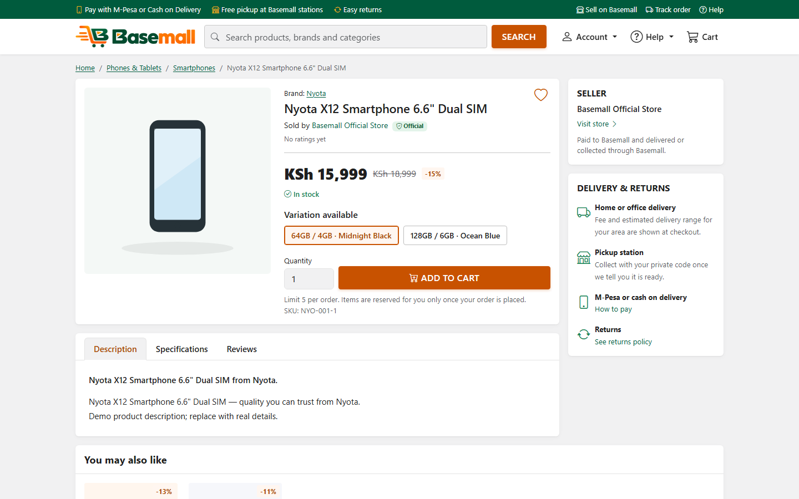
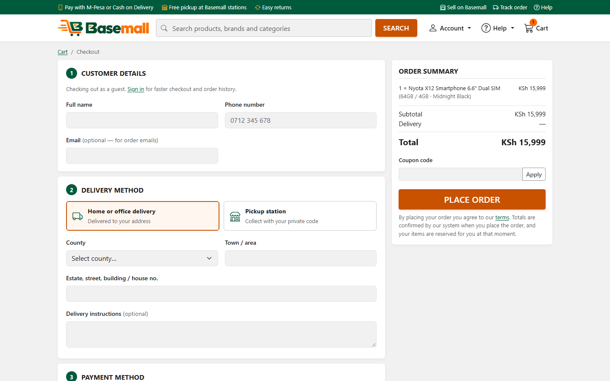
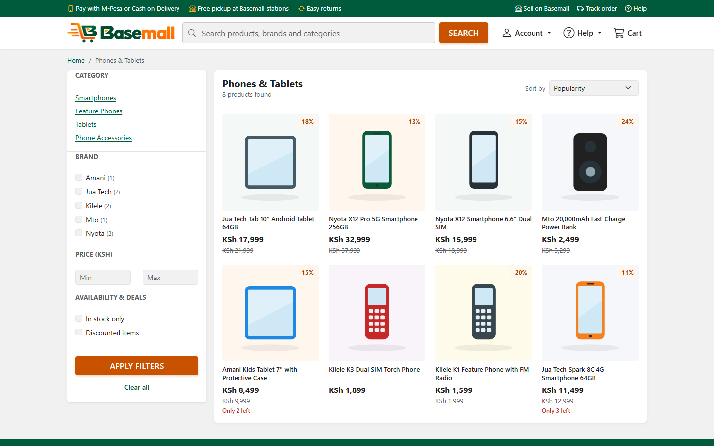
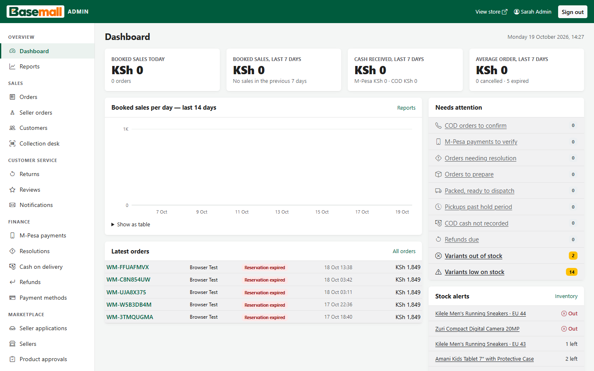
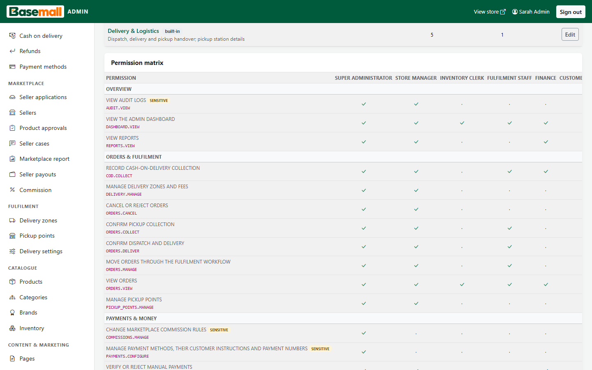
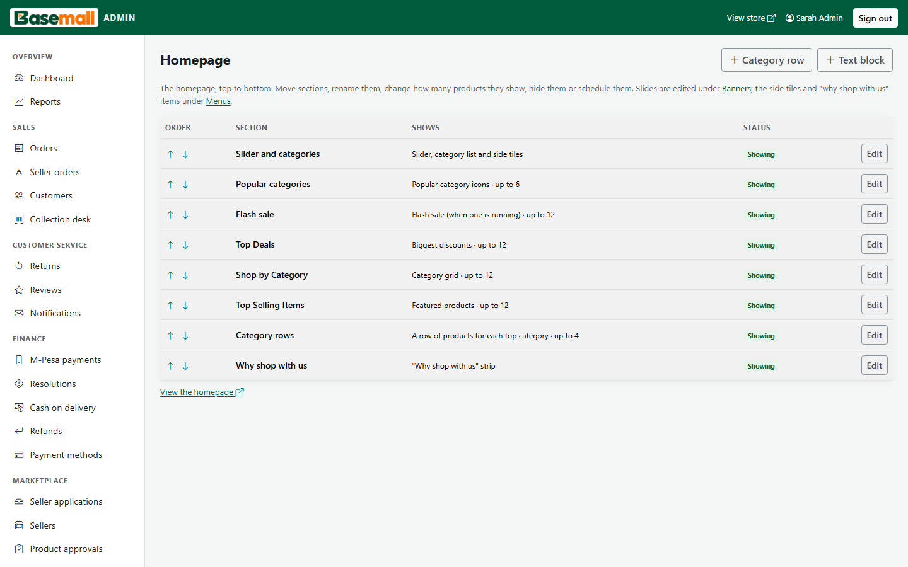
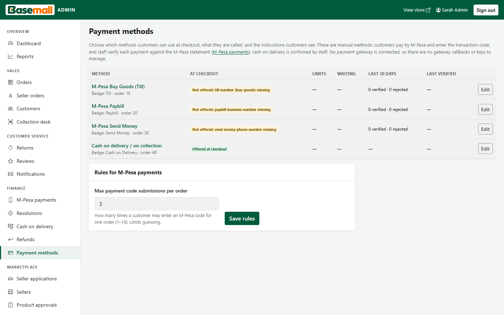
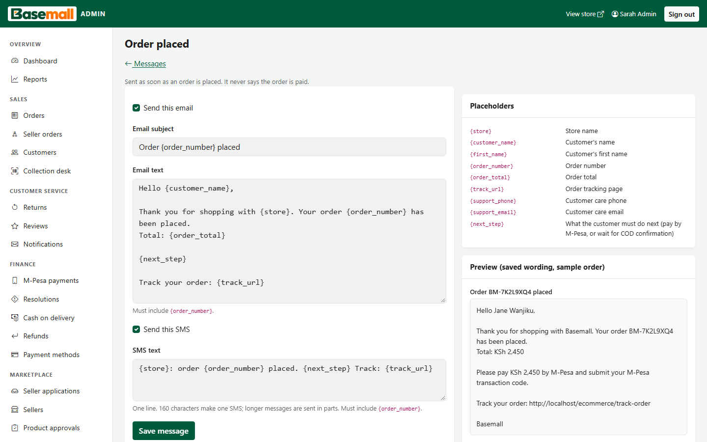

# Ecommerce: multi-vendor e-commerce marketplace for Kenya

**Everything you need, one store.**

Ecommerce is a complete online marketplace built for the Kenyan market. Customers can shop from many sellers in one cart and pay by M-Pesa or cash on delivery, then get their order delivered or collect it from a pickup station. Sellers run their own stores from a Seller Centre. Staff run the platform from an admin dashboard with role-based access, and all content and settings are managed from the admin, with no code changes.

Designed and built by **[Duncan Kinyua Gathogo](#author)** · [Dira Systems Ltd](http://dirasystems.co.ke/)


## Highlights

- **Marketplace:**
  - seller applications with document review;
  - seller stores and product moderation;
  - orders split per seller;
  - commission rules;
  - an append-only seller ledger, payout requests and reconciliation reports.
- **Kenyan checkout:**
  - M-Pesa (Till, Paybill, Send Money) with staff verification, plus cash on delivery;
  - delivery zones by county and town, pickup stations with private collection codes;
  - sign-in with an email or a phone number in any common format (0712…, +254…).
- **Correct under pressure:**
  - stock is reserved inside database transactions, so two customers can never buy the last unit;
  - money is handled as exact decimals;
  - refunds are capped and checked in races between concurrent requests;
  - every seller balance reconciles to the cent, verified on a 100,000-row ledger.
- **Managed from the admin, not the code:**
  - branding (logo, colours, tagline);
  - grouped settings with export and import;
  - pages with drafts, scheduling and revisions;
  - menus and a homepage section builder;
  - payment methods and delivery rules;
  - the wording of every email and SMS.
- **Security:**
  - role-based access with an editable permission matrix and no self-escalation;
  - optional two-step sign-in (TOTP) with recovery codes;
  - rate-limited sign-in and a sign-in activity log;
  - an append-only audit log enforced by database triggers;
  - CSRF protection, encrypted secrets, and private storage for seller documents.
- **Quality:**
  - **473 automated tests** (unit, integration on a real database, HTTP);
  - a role × page access matrix generated from the live routes;
  - accessibility (axe) and responsive checks on all 103 page types, at phone, tablet and desktop sizes.

## Screenshots

| Product page | Checkout |
|---|---|
|  |  |
| **Category listing** | **Admin dashboard** |
|  |  |
| **Roles & permissions matrix** | **Homepage builder** |
|  |  |
| **Payment methods** | **Email & SMS templates** |
|  |  |

<p align="center"></p>

## Technology

| Layer | Choice |
|---|---|
| Back end | PHP 8.2 (no framework: its own router, middleware, validation, sessions and CSRF), PDO |
| Database | MariaDB 10.4 / MySQL. 24 versioned migrations with tested rollback scripts, triggers for append-only ledgers and logs |
| Front end | Bootstrap 5, vanilla JavaScript, server-rendered pages, accessible markup |
| Email | PHPMailer over SMTP (settings and an encrypted password managed in the admin) |
| Testing | PHPUnit 10, a parallel-process concurrency harness, Puppeteer with axe-core for browser checks |

The code is organised into thin controllers, services that hold all business rules, and a small core. [docs/ARCHITECTURE.md](docs/ARCHITECTURE.md) has the details. The internal code name `Waimart` (PHP namespace, database name) dates from before the rebrand and is kept on purpose.

## Getting started (development)

Requires PHP 8.2+ (with bcmath, gd, mbstring, openssl, pdo_mysql), MariaDB 10.4+ or MySQL 8, and Composer. Tested on Windows with XAMPP.

```bash
composer install
php bin/install.php            # creates the databases and config/config.local.php with a random app key
php bin/migrate.php            # applies all migrations
php bin/create-admin.php --email=you@example.com   # prints a one-time password
php bin/seed-demo.php          # optional demo catalogue
vendor/bin/phpunit             # runs the test suite
```

Then open `http://localhost/ecommerce/` (the shop) and `/admin/login` (the admin). The full guide is [docs/INSTALL.md](docs/INSTALL.md).

## Documentation

| Document | Contents |
|---|---|
| [INSTALL](docs/INSTALL.md) | Installation, configuration, going live |
| [OPERATIONS](docs/OPERATIONS.md) | Scheduled jobs, daily checks, staff and security procedures |
| [ARCHITECTURE](docs/ARCHITECTURE.md) | Code structure, data model and design decisions |
| [BACKUP_RESTORE](docs/BACKUP_RESTORE.md) | Backups, restore, rebuilding on a new machine |
| [SELLER_GUIDE](docs/SELLER_GUIDE.md) | How sellers use the Seller Centre |
| [MARKETPLACE_PLAN](docs/MARKETPLACE_PLAN.md) | The multi-vendor upgrade, phase by phase |
| [REBRAND_NOTES](docs/REBRAND_NOTES.md) | The rebrand and the database-driven management work, stage by stage |
| [REBRAND_FINAL_REPORT](docs/REBRAND_FINAL_REPORT.md) | Deliverables, test results and deployment steps |

## Author


**Duncan Kinyua Gathogo**, software developer<br>
[Dira Systems Ltd](http://dirasystems.co.ke/): AI-driven ICT solutions in Nanyuki, Kenya: software, networking, CCTV, cloud and automation<br>
Website: [dirasystems.co.ke](http://dirasystems.co.ke/) · Email: [info@dirasystems.co.ke](mailto:info@dirasystems.co.ke)

<br clear="left">

Available for software projects and roles. Get in touch through the website.

## Licence

Copyright © 2026 Duncan Kinyua Gathogo. All rights reserved. The source is published so it can be reviewed. It may not be copied, modified or used commercially without written permission. See [LICENSE](LICENSE).
